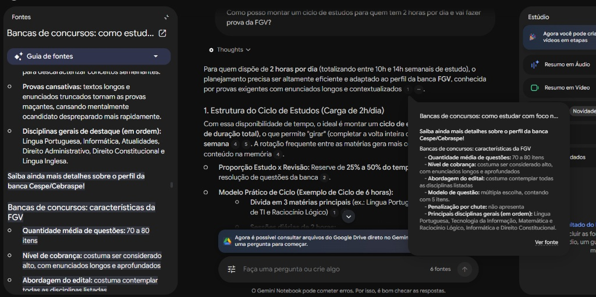
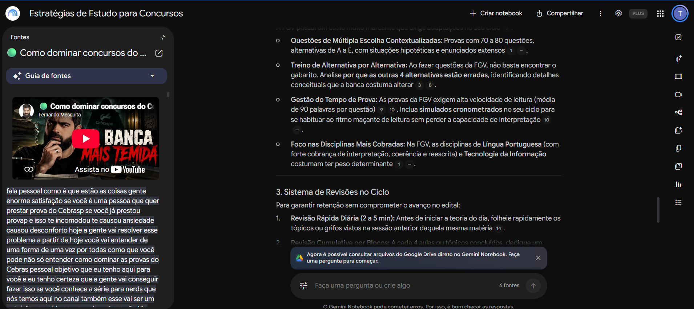
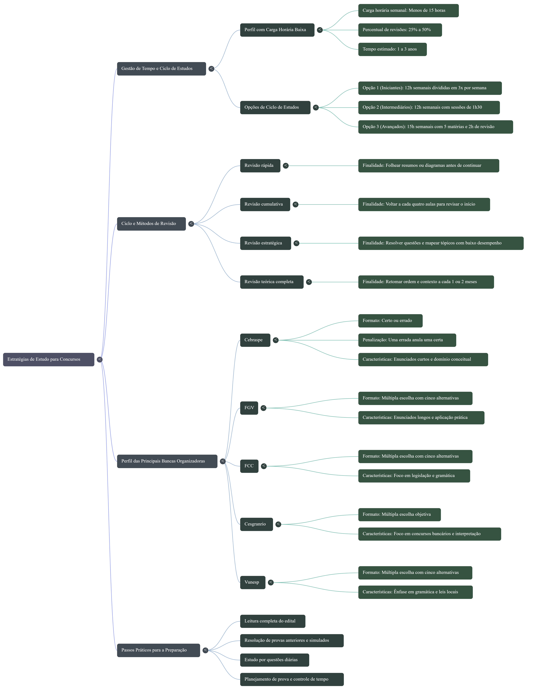

# Segundo Cérebro: Estratégias de Estudo para Concursos

Projeto desenvolvido para o desafio da DIO utilizando o **Gemini Notebook** (antigo NotebookLM) para criar um assistente especialista em preparação para concursos públicos.

🔗 **Acesse o Notebook:** [Estratégias de Estudo para Concursos](https://notebooklm.link.google/jBOrH25kL3gC)

---

## Tema e Objetivo
**Tema:** Estratégias de estudo para concursos públicos (gestão de tempo, ciclos de revisão e perfil de bancas).

**Objetivo:** Construir um segundo cérebro especialista em estratégias de estudo para concursos, capaz de adaptar cronogramas, revisões e resolução de questões ao meu tempo disponível e ao perfil de cada banca organizadora.

---

## Fontes Selecionadas e Critérios de Confiabilidade
Para evitar conteúdos genéricos ou promessas irreais de estudo, selecionei **5 fontes** em formatos variados (textos e vídeos) focando em metodologia prática e análise técnica de bancas:

1. **[Ciclo de Estudos por Carga Horária (Estratégia Concursos)](https://gratis.estrategiaconcursos.com.br/ciclo2/)** — *Artigo:* Traz divisões práticas de horas para quem tem menos de 15h semanais disponíveis e define o percentual ideal para revisões.
2. **[Perfil das Bancas: FCC, FGV, Cebraspe, Cesgranrio e Vunesp (Ache Concursos)](https://www.acheconcursos.com.br/artigos/perfil-das-bancas-como-sao-as-provas-de-fcc-fgv-cebraspe-cesgranrio-e-vunesp-94116)** — *Artigo:* Apresenta um comparativo direto sobre o estilo de cobrança e o formato das questões das cinco principais bancas do país.
3. **[Como estudar com foco no perfil da banca (Blog Gran Cursos)](https://blog.grancursosonline.com.br/bancas-de-concursos-perfil/)** — *Artigo:* Detalha aspectos operacionais decisivos, como a penalização por chute no Cebraspe e o tamanho dos enunciados na FGV.
4. **[Como fazer revisões para concurso público (YouTube)](https://www.youtube.com/watch?v=_tCWN2fJPFo)** — *Vídeo:* Explica de forma aplicável a diferença entre revisão rápida diária e revisão cumulativa por blocos.
5. **[Como dominar concursos do Cebraspe - Fernando Mesquita (YouTube)](https://www.youtube.com/watch?v=wjqzFwx2Ykk)** — *Vídeo:* Análise aprofundada feita por um especialista reconhecido na área, comparando literalidade, distratores e estratégia de prova.

---

## Diretriz de Comportamento (Prompt do Chat)
Nas configurações do chat do Gemini Notebook, utilizei a seguinte diretriz personalizada:

> *"Comporte-se como um especialista em estratégias de estudo para concursos públicos. Seu objetivo é me ajudar a montar cronogramas, ciclos de estudo, revisões e estratégias de prova adaptadas ao meu tempo disponível e ao perfil de cada banca organizadora, baseando-se estritamente nas fontes fornecidas."*

---

## Perguntas Realizadas e Evidências (Citações)

### 1. Adaptação de ciclo de estudos para pouco tempo + Banca FGV
* **Pergunta:** *"Como posso montar um ciclo de estudos para quem tem 2 horas por dia e vai fazer prova da FGV?"*
* **Resposta e Fontes:** O notebook estruturou um ciclo de 6 horas (para girar várias vezes na semana), recomendando reservar de 25% a 50% do tempo para resolução de questões e alertando sobre os enunciados longos e contextualizados da FGV. As informações foram extraídas diretamente dos artigos do **Gran Cursos** e do **Estratégia Concursos**.

### 2. Treino de alternativas e sistema de revisões
* **Pergunta:** *(Continuação da análise para FGV e revisões)*
* **Resposta e Fontes:** O assistente detalhou a técnica de analisar alternativa por alternativa na FGV, o controle de tempo para leitura rápida e dividiu o sistema de revisões entre *Revisão Rápida Diária* (2 a 5 min) e *Revisão Cumulativa por Blocos*, cruzando os dados dos artigos com os vídeos do **YouTube**.

---

## Materiais Gerados no Estúdio
A partir do cruzamento de todas as fontes, gerei o **Mapa Mental** abaixo consolidando a gestão de tempo, os tipos de revisão, as características de cada banca e os passos práticos da preparação:

